# Lab 3: REST API, Query Parameters, Validation, and Debugging

**Subject :** Backend Development Fundamentals


**Year/Term:** Year II, Term II


**University:**Aurora Deemed to be University


**Faculty:** Mr. Joel Prashanth D


## 1. Student details

- **Full name:** Abhinav Reddy
- **Registration number:** 252U1R9173
- **Section:** S-26

## 2. Live link

**Live link:** Not deployed

Run the API locally at [http://localhost:3000](http://localhost:3000).

## 3. Lab objective

This lab practices building and testing a REST API with Node.js and Express. The API stores books in a SQLite database using `better-sqlite3`. It demonstrates route parameters, query parameters for searching and filtering, sorting and pagination, request validation, appropriate HTTP status codes, and debugging common local development issues.

## 4. Project structure

```text
lab-3/
├── app.js                         # Express server, routes, validation, and database setup
├── app.http                       # HTTP request examples for testing the API
├── books.db                       # SQLite database (created by the app if missing)
├── package.json                   # Project metadata, scripts, and dependencies
├── package-lock.json              # Locked dependency versions
└── screenshots/                    # API screenshots shown in this README
```

The database file is opened relative to the directory from which the app is started. Start the commands below from the `lab-3` project directory.

## 5. Requirements, installation, and running

### Requirements

- Node.js and npm installed on your computer
- PowerShell on Windows

### Install dependencies

Open PowerShell in the `lab-3` directory and run:

```powershell
npm.cmd install
```

### Start the server

For the regular start script:

```powershell
npm.cmd start
```

For development with automatic restarts:

```powershell
npm.cmd run dev
```

The server uses `process.env.PORT` when it is set; otherwise, it listens on port `3000`. With the default port, open [http://localhost:3000](http://localhost:3000). Keep the terminal running while you send requests. Press `Ctrl+C` in that terminal to stop the server.

`npm.cmd` invokes npm through its Windows command shim. It is useful in PowerShell when the `npm.ps1` script is blocked by the execution policy.

## 6. Database and table

The app uses SQLite through `better-sqlite3`. On startup, it opens or creates `books.db`, then creates the `books` table if the table does not already exist.

| Column | Type | Description |
|---|---|---|
| `id` | `INTEGER PRIMARY KEY AUTOINCREMENT` | Unique identifier assigned to each book |
| `title` | `TEXT NOT NULL` | Book title |
| `author` | `TEXT NOT NULL` | Author name |
| `price` | `REAL NOT NULL` | Book price |

The API inserts, reads, updates, and deletes records in this table. The database is local and is not included in the GitHub submission.

## 7. Endpoints

| Method and path | Description | Successful response |
|---|---|---|
| `GET /` | Health check | `200 OK` with `{"message":"Lab 3 API is running"}` |
| `GET /books` | List books; supports search, sorting, pagination, and price bounds | `200 OK` with a JSON array |
| `GET /books/:id` | Get one book by its ID | `200 OK` with a book object |
| `POST /books` | Create a book | `201 Created` with the created book object |
| `PUT /books/:id` | Replace a book's title, author, and price | `200 OK` with the updated book object |
| `DELETE /books/:id` | Delete a book | `200 OK` with a success message |

Book objects have this shape:

```json
{
  "id": 1,
  "title": "The Hobbit",
  "author": "J. R. R. Tolkien",
  "price": 15.99
}
```

## 8. `GET /books` query parameters

All parameters are optional. If omitted, the API uses the defaults shown below.

| Parameter | Default | Description |
|---|---:|---|
| `search_q` | `""` (empty string) | Matches a partial title. For example, `?search_q=Hob` finds titles containing `Hob`. |
| `order_by` | `title` | Field to sort by. Allowed values: `title`, `author`, `price`. |
| `order` | `ASC` | Sort direction. Allowed values: `ASC` or `DESC` (case-insensitive). |
| `limit` | `10` | Maximum number of books returned; must be a positive integer. |
| `offset` | `0` | Number of matching books to skip; must be zero or a positive integer. |
| `min_price` | Not set | Optional inclusive lower price bound; must be numeric when provided. |
| `max_price` | Not set | Optional inclusive upper price bound; must be numeric when provided. |

When both price bounds are supplied, `min_price` must not be greater than `max_price`. For example:

```text
GET /books?search_q=pride&order_by=price&order=DESC&limit=5&offset=0&min_price=5&max_price=20
```

## 9. Example JSON body for creating or updating a book

Both `POST /books` and `PUT /books/:id` expect a JSON object containing all three fields:

```json
{
  "title": "Pride and Prejudice",
  "author": "Jane Austen",
  "price": 10.5
}
```

Send the request with the `Content-Type: application/json` header.

## 10. Validation and JSON errors

- `title` and `author` must be non-empty strings. Leading and trailing whitespace is removed before saving.
- `price` is required and must be a finite number. A numeric string is accepted and converted to a number.
- `order_by` must be one of `title`, `author`, or `price`.
- `order` must be `ASC` or `DESC`.
- `limit` must be a positive integer; `offset` must be zero or a positive integer.
- Provided `min_price` and `max_price` values must be numeric, and the minimum cannot exceed the maximum.
- A request with malformed JSON receives a `400 Bad Request`.
- A book lookup, update, or deletion for an ID that does not exist receives `404 Not Found`.

Errors use a consistent JSON object with a `message` field. For example:

```json
{
  "message": "Book not found"
}
```

The text of `message` describes the problem, such as a missing required book field, an invalid query parameter, malformed JSON, or an internal server error.

## 11. Expected HTTP status codes

| Status | Meaning in this API |
|---|---|
| `200 OK` | Successful health check, list, lookup, update, or delete |
| `201 Created` | Book created successfully |
| `400 Bad Request` | Invalid input, invalid query parameter, or malformed JSON |
| `404 Not Found` | Requested book ID does not exist |
| `500 Internal Server Error` | Unexpected server-side error |

## 12. Postman test checklist

Use `http://localhost:3000` as the base URL. Start the server before testing. These are expected results for the requests, not a record that the tests have been run.

### Success cases

- [ ] `GET /` — expect `200` and `{"message":"Lab 3 API is running"}`.
- [ ] `POST /books` with the example JSON body — expect `201` and a book object containing an `id`.
- [ ] `GET /books` — expect `200` and a JSON array.
- [ ] `GET /books?search_q=Hob` — expect `200`; matching titles are returned.
- [ ] `GET /books?order_by=price&order=DESC` — expect `200`; results are sorted by descending price.
- [ ] `GET /books?limit=1&offset=0` — expect `200`; at most one result is returned.
- [ ] `GET /books?min_price=10&max_price=20` — expect `200`; returned prices are within the inclusive range.
- [ ] `GET /books/{existing-id}` — expect `200` and that book's object.
- [ ] `PUT /books/{existing-id}` with a valid JSON body — expect `200` and the updated book object.
- [ ] `DELETE /books/{existing-id}` — expect `200` and `{"message":"Book deleted successfully"}`.

### Failure cases

- [ ] `POST /books` with a missing title, blank title/author, or non-numeric price — expect `400` and a JSON `message`.
- [ ] `PUT /books/{existing-id}` with invalid book fields — expect `400` and a JSON `message`.
- [ ] `GET /books?order_by=publisher` — expect `400` and a JSON `message`.
- [ ] `GET /books?order=SIDEWAYS` — expect `400` and a JSON `message`.
- [ ] `GET /books?limit=0` or `GET /books?offset=-1` — expect `400` and a JSON `message`.
- [ ] `GET /books?min_price=20&max_price=10` — expect `400` and a JSON `message`.
- [ ] Send malformed JSON to `POST /books` — expect `400` and a JSON `message`.
- [ ] `GET /books/{nonexistent-id}` — expect `404` and `{"message":"Book not found"}`.
- [ ] `PUT /books/{nonexistent-id}` — expect `404` and a JSON `message`.
- [ ] `DELETE /books/{nonexistent-id}` — expect `404` and `{"message":"Book not found"}`.

## 13. Screenshots

The screenshots below are image files currently present in `screenshots/`.

### Health check

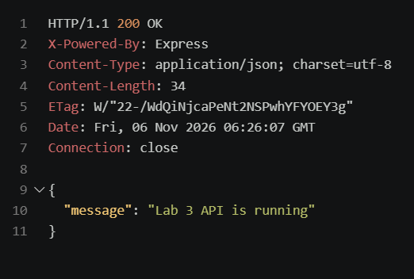

### Create book

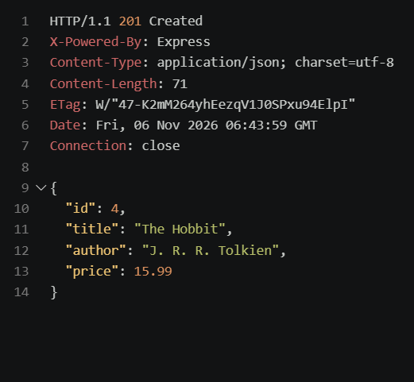

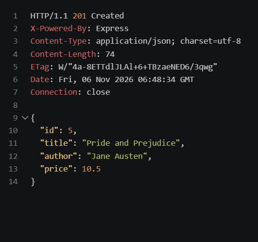

### List, search, sort, and filter

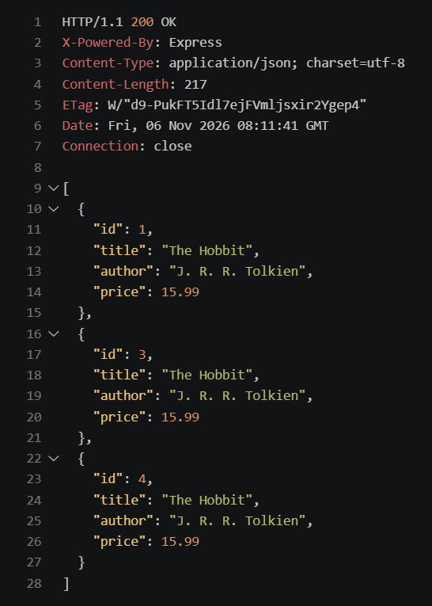

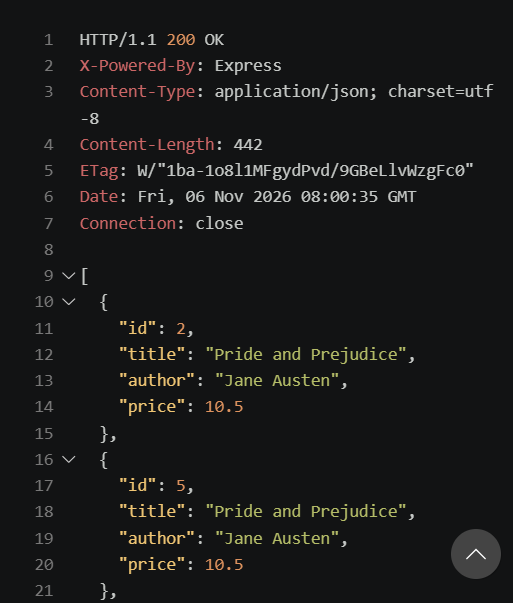

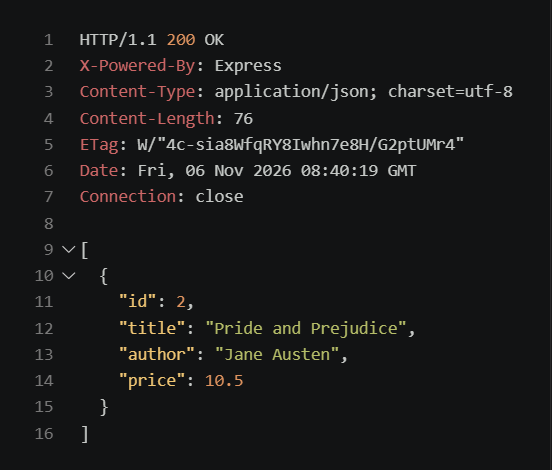

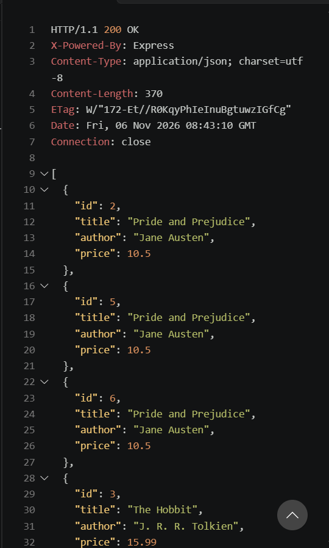

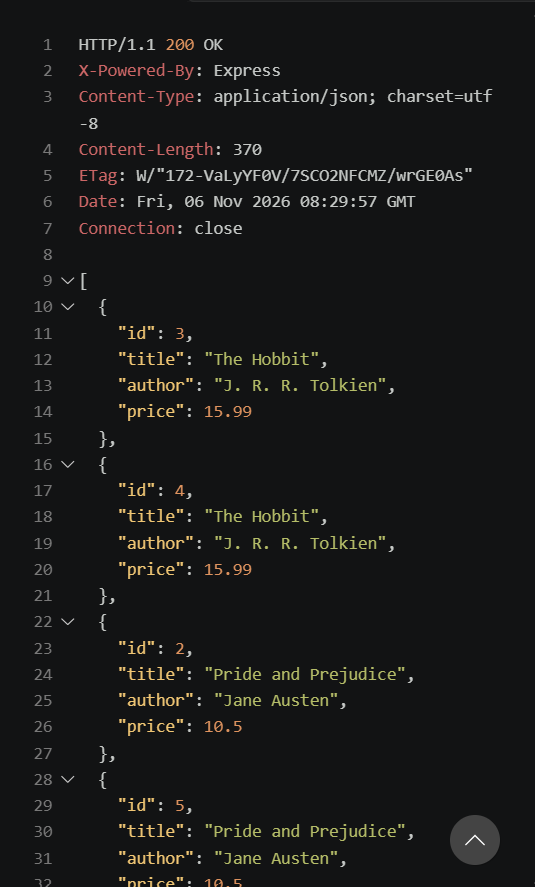

### Invalid input

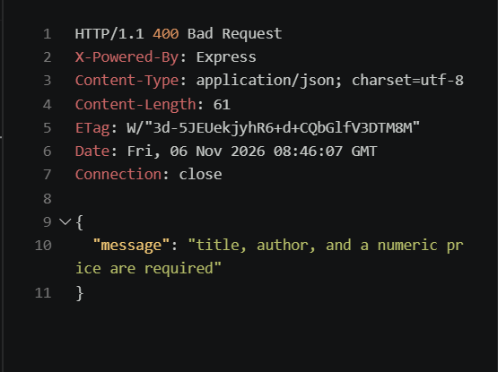

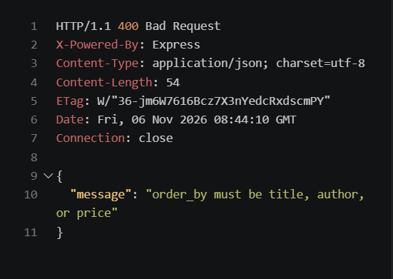

### Missing records

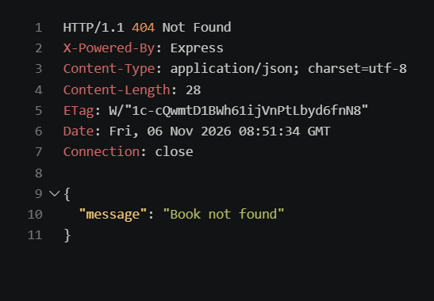

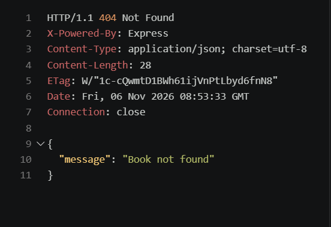

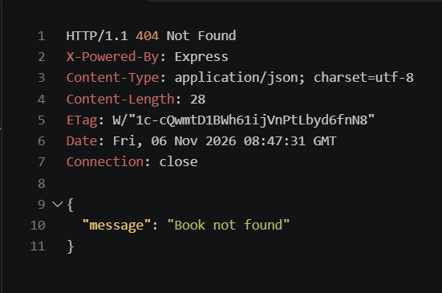

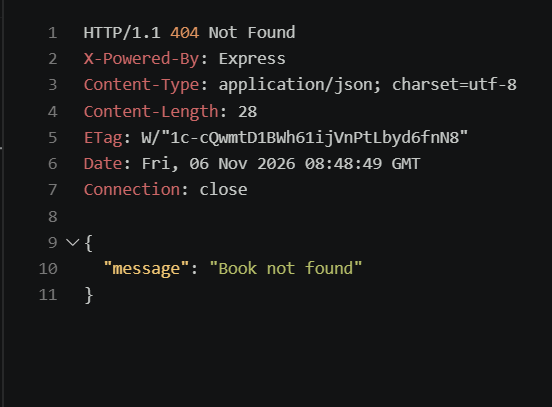

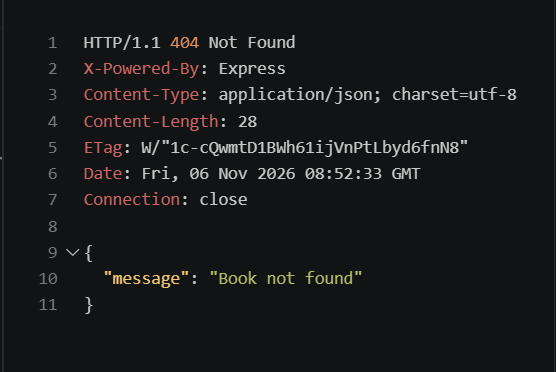

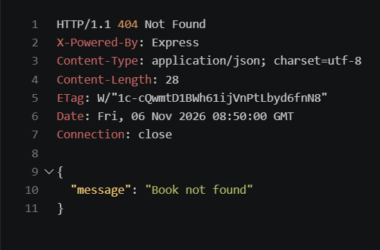

Successful update and successful delete screenshots are not currently present. Add those screenshots after capturing them; the missing-record screenshots above show failure cases, not successful update or delete operations.

## 14. Debugging notes

- PowerShell blocked `npm.ps1`, so `npm.cmd` commands were used instead.
- The package scripts were corrected to run `app.js`.
- `better-sqlite3@12.10.0` was installed after the initial native build issue.
- A `connection refused` message usually means the API server is not running. Start it with `npm.cmd start` and retry the request.


